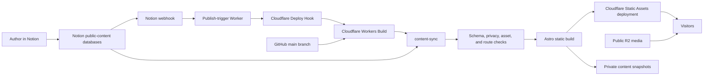
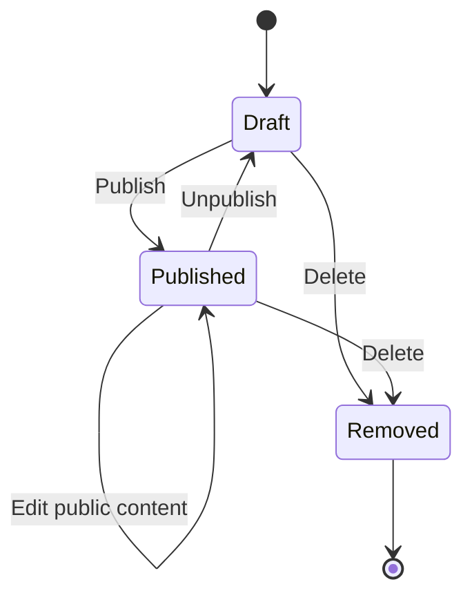
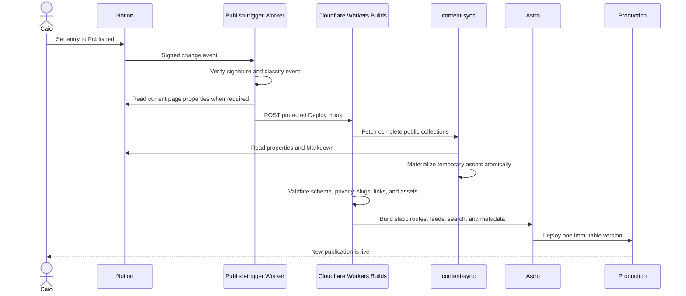
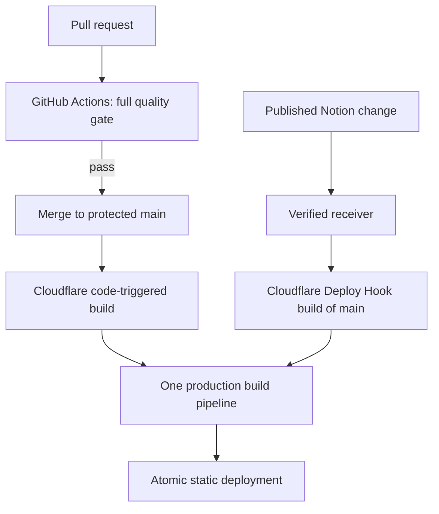

# Publishing architecture

Status: Accepted; implementation in progress

## Decision

Use Notion as the editorial source of truth, but never as a dependency of a
visitor request. A publication event triggers a new Cloudflare build. During
that build, the existing content-sync package fetches the complete public
dataset, materializes temporary Notion assets, validates the result, and gives
Astro local files from which to generate the static website.

The deployed website remains a static Cloudflare Worker with Static Assets. It
does not receive a Notion token, call Notion, or render editorial content at
runtime.

In one sentence:

> Notion edits state, Cloudflare builds a snapshot, and Astro serves that
> snapshot as static files.

## Why this is the recommended boundary

This design provides phone-friendly, commit-free publishing without trading
away the properties that already make the website reliable:

- Visitors receive static HTML, feeds, search data, metadata, and assets.
- A Notion or build outage cannot take the currently deployed site offline.
- Draft filtering and privacy checks happen before deployment, not per request.
- Search, RSS, sitemap, Open Graph metadata, and routes all describe the same
  immutable content snapshot.
- Notion's temporary signed file URLs are downloaded during the build and never
  appear in deployed content.
- The current hexagonal content-sync package remains the acquisition boundary.

Calling Notion live would require a server-side Worker, cache invalidation,
runtime draft filtering, request-time error handling, and a media proxy. That
would turn a static portfolio into a small CMS backend without improving the
authoring experience.

## Goals

- Write, edit, and publish from Notion, including from a phone.
- Publish without manually generating or committing Markdown.
- Keep the public Git repository free of drafts and imported personal metadata.
- Keep the production website static, fast, searchable, and independently
  available when Notion is unavailable.
- Preserve deterministic validation before content becomes public.
- Make unpublishing and rollback explicit and recoverable.
- Keep large canonical media outside Git.

## Non-goals

- Serving page content directly from Notion at request time.
- Building a general-purpose CMS or editorial collaboration product.
- Providing an authenticated website preview in the first migration stage.
- Automatically uploading arbitrary large media to R2 from every build.
- Committing generated Notion exports back into the public repository.
- Applying semantic versions to each content publication.

## System map



The two important boundaries are:

1. Notion can trigger and supply a build, but it cannot answer a visitor request.
2. Generated content can enter a build workspace and a private backup, but it
   cannot enter public Git history.

## Ownership

| Concern | Source of truth | Stored in public Git? | Used at runtime? |
| --- | --- | --- | --- |
| Application code and infrastructure configuration | GitHub | Yes | Static output only |
| Content schemas and publication rules | GitHub | Yes | Compiled into the build |
| Editorial entries, podcast metadata, talks, and projects | Notion | No | No |
| Generated Markdown and materialized inline images | Build workspace | No | Compiled output only |
| Site copy such as navigation, About, and Contact | GitHub | Yes | Static output only |
| Small page-critical design assets | GitHub | Yes | Yes, as static assets |
| Canonical audio, video, PDFs, and editable presentations | Public R2 | No | Yes, through stable URLs |
| Successful normalized content snapshots | Private R2 | No | No; recovery only |
| Deployed website | Cloudflare Worker versions and Static Assets | No | Yes |

GitHub therefore remains current for the publishing system. It intentionally
does not mirror the editorial database. A production deployment is identified
by both a code revision and a content revision:

```text
deployment = Git commit SHA + public content digest
```

This is the same separation used by a conventional application whose code is in
Git while its production records are in a database.

## Content lifecycle

Notion owns the editorial state model:



- The Notion adapter checks the source status before mapping a record.
- Only the exact source value `Published` is included in the next candidate
  snapshot. Compatibility aliases such as `Done` or `Archive` are not public.
- Draft bodies and assets are never read or exported.
- Moving a published entry back to `Draft` removes it in the next deployment.
- Deleting a public entry also triggers a rebuild that removes its route.
- Once a record crosses the adapter boundary, workflow status no longer exists.
  Public domain objects, Markdown frontmatter, feeds, search documents, and agent
  indexes contain only publishable metadata.

An edit does not mutate the deployed page. It creates a candidate for the next
immutable deployment.

## Publishing sequence



The webhook payload is never treated as content. Notion documents that webhook
events are change signals and recommends fetching current state because events
may be aggregated or delivered out of order.

## Webhook receiver

Use a small, separately deployed Cloudflare Worker. Its only responsibility is
to translate trusted Notion events into build triggers.

It should:

1. Read the raw request body.
2. Verify `X-Notion-Signature` using the webhook verification token.
3. Accept only relevant page content, property, move, and deletion events.
4. Confirm that the event belongs to an allowlisted content data source.
5. For content edits, retrieve the page and trigger only when it is currently
   public.
6. For property changes, moves, or deletion, trigger a build even when the page
   is no longer public so production can remove it.
7. POST the secret Cloudflare Deploy Hook URL.
8. Return quickly and log only event type, result, and a non-sensitive event ID.

The receiver does not transform Markdown, store articles, or deploy assets. It
does not need a queue or database in the initial implementation. Duplicate
builds are safe, and Cloudflare deduplicates Deploy Hook calls received while a
build is queued or initializing.

### Receiver secrets

- `NOTION_WEBHOOK_VERIFICATION_TOKEN`
- `NOTION_TOKEN` with read-only access to the public-content data sources
- `CLOUDFLARE_DEPLOY_HOOK_URL`
- Allowlisted data-source identifiers

The Deploy Hook URL is itself a credential. It must live in a Worker secret,
never in `wrangler.jsonc`, source code, logs, or Notion properties.

## Build and deployment authority

Use Cloudflare Workers Builds as the one build-and-deploy environment:

- Connect the `amaral-codes` Worker to the public GitHub repository.
- Use `main` as the production branch.
- Keep direct pushes to `main` disabled through branch protection.
- GitHub Actions remains the required code-quality gate for pull requests.
- A merge to `main` produces the normal code-triggered Cloudflare build.
- The Notion receiver invokes a Deploy Hook for the same `main` branch when
  public content changes.
- Both paths execute the same content acquisition and static build commands.

This avoids storing Cloudflare deployment credentials in GitHub. Cloudflare's
Git integration owns its generated deployment token, while Notion only reaches
the protected receiver.



### Production build stages

The intended Cloudflare build is conceptually:

```text
1. Check out the current protected main commit
2. Install locked dependencies
3. Fetch all public Notion collections
4. Write generated Markdown and inline assets to ignored staging directories
5. Atomically replace each generated collection
6. Validate schemas, public metadata, privacy rules, URLs, assets, and slugs
7. Build Astro pages, search index, feeds, sitemap, Open Graph metadata, and PWA
8. Run a focused static-content smoke test
9. Record the code SHA and content digest
10. Deploy the complete static asset version
```

Code changes still receive the repository's full lint, type, unit, coverage,
CRAP, browser, and performance gates in GitHub before merge. Content-triggered
builds should rerun content safety checks and the Astro build, but they do not
need the entire expensive browser and performance suite for unchanged code.

## Repository layout

The current architecture already has the right package boundaries:

```text
packages/
  content-contract/     public schema, identifiers, and URL policy
  content-sync/         Notion acquisition and filesystem materialization
  website/              Astro rendering and static behavior
```

The build materializes content into ignored `synced/` areas so Astro can use
its normal content loader without committing the public snapshot:

```text
packages/website/src/content/
  entries/
    synced/
      editorial/
      podcasts/
  projects/
    synced/
```

These generated directories become build artifacts and must be ignored by Git.
Hand-maintained entries can remain during migration, but new recurring editorial
content should have one canonical authoring path: Notion. Supporting two equal
sources indefinitely would reintroduce ambiguity over which copy wins.

Generated snapshots are build artifacts and remain ignored by Git. Only
hand-maintained migration content and deterministic public fixtures are tracked.

## Asset lifecycle

### Inline article images

1. Add the image to the Notion page while writing.
2. Notion returns a temporary signed URL through its Markdown API.
3. `content-sync` downloads the file during the build.
4. The adapter validates the source, size, and media type.
5. The image is converted to the website's supported format and referenced
   locally by generated Markdown.
6. Astro includes the materialized image in the static deployment.

The temporary Notion URL is discarded. This is required because Notion's file
URLs expire after a short period.

### Large or canonical media

Audio episodes, video, PDFs, Keynote files, and PowerPoint files should use
stable URLs under `assets.amaral.codes` backed by public R2. Their metadata and
links live in Notion, but the binary does not pass through every website build.

### Repository assets

Git should contain only assets that are part of the website implementation or
small, page-critical presentation:

- icons and favicons
- fonts and textures
- logo treatments
- small optimized thumbnails or previews whose change belongs with code

The rule is based on ownership, not only file size: content attachments follow
content; application assets follow code; canonical media follows object storage.

## Preview workflow

### First release

- Draft and edit in Notion.
- Use Notion itself as the editorial preview.
- Publish to see the exact website rendering.
- If the production rendering is wrong, unpublish or roll back immediately.

This is intentionally minimal and supports phone publishing without exposing a
second private application surface.

### Optional protected preview

Add this only if Notion preview proves insufficient:

```text
Status = Preview
  -> preview Deploy Hook
  -> a separate preview-only adapter policy includes Preview + Published
  -> preview.amaral.codes
  -> protected by Cloudflare Access
```

This is not part of the current sync contract. Production must never receive
preview credentials or include preview records.
The preview Worker, domain, build variables, and content snapshot are separate.

## Rollback and recovery

There are two distinct rollback cases.

### Operational rollback

If a successful deployment has a rendering or code regression, activate the
previous Cloudflare Worker version. This restores the previous complete static
snapshot without querying Notion.

### Editorial rollback

If an entry itself is wrong:

1. Restore the page through Notion history or change its status to `Draft`.
2. Trigger another content build.
3. Deploy the corrected complete snapshot.

Private normalized snapshots in R2 are a future recovery improvement, not part
of the current release path. Today, editorial recovery uses Notion history and
operational recovery uses a prior Cloudflare Worker version.

When private snapshot storage is introduced, every successful production build
should create a normalized snapshot containing:

- sanitized generated Markdown
- materialized inline images
- Git commit SHA
- content digest
- publication timestamp
- public slugs and collection counts

Store that future snapshot in a private R2 bucket. It is recovery data, not a second authoring
source. A practical retention policy is the latest 30 successful snapshots plus
one monthly snapshot for a year.

## Failure behavior

| Failure | Expected behavior |
| --- | --- |
| Notion is unavailable | New build fails; current static site remains online |
| Notion webhook is delayed or missed | Current site remains online; manually invoke the Deploy Hook |
| Webhook signature is invalid | Receiver rejects the request; no build starts |
| Draft or private metadata reaches generated output | Privacy validation fails; no deployment |
| Duplicate or invalid slug | Content sync fails before replacing the snapshot |
| Notion file download expires or fails | Build fails; current deployment and prior snapshot remain |
| Astro or route generation fails | No new deployment |
| R2 canonical media is unavailable | Static pages remain available; affected media is unavailable |
| Content changes during a build | A later webhook starts another complete build from current state |
| Deploy Hook URL leaks | Delete and rotate the hook; receiver secret is updated |

The invariant is that content acquisition failure can delay publishing but
cannot degrade the deployed website.

## Security and privacy model

- Give the Notion integration access only to dedicated website databases.
- Use read-only Notion capabilities for the production build and receiver.
- Keep Notion tokens in Cloudflare build or Worker secrets, not runtime static
  bindings and not GitHub.
- Validate Notion webhook HMAC signatures against the raw body.
- Treat the Deploy Hook URL as a secret and rotate it if exposed.
- Never log article bodies, signed URLs, tokens, page IDs, or source metadata.
- Continue rejecting Notion URLs, signed attachment URLs, workflow states,
  credential-bearing URLs, and private workflow metadata from public output.
- Do not commit build snapshots, webhook payloads, or generated content to the
  public repository.
- Keep the static website Worker free of Notion and R2 administrative bindings.

## Observability

Each build should report a small, non-sensitive summary:

```text
trigger: code | content | manual
git_commit: <sha>
content_digest: <sha256>
entries: <count>
projects: <count>
generated_assets: <count and total bytes>
result: deployed | rejected
```

Do not print source page identifiers or raw content. Cloudflare's build UUID and
the content digest are sufficient to correlate a webhook trigger, build log,
private snapshot, and deployed version.

Alerts should be limited to actionable failures:

- three consecutive failed content builds
- failed webhook signature verification above a small threshold
- a production build with unexpectedly large content or asset-count changes
- backup snapshot failure after an otherwise successful build

## Migration plan

### Stage 1: Establish a reproducible baseline

- Record current route, feed, search-index, and content counts.
- Confirm a clean production build from the current branch.
- Confirm the current generated output passes privacy and asset checks.
- Do not remove any existing Markdown yet.

### Stage 2: Make content generation build-safe

- Add an explicit production content-build command.
- Run `content-sync` before Astro in a clean workspace.
- Ignore generated content and staging directories.
- Ensure an empty or invalid Notion response cannot erase the last candidate
  snapshot or produce a deployment.
- Generate a content digest and private manifest.

### Stage 3: Connect Cloudflare Workers Builds

- Connect the existing `amaral-codes` Worker to the GitHub repository.
- Configure `main`, build commands, and build-time Notion secrets.
- Require GitHub CI before `main` can be updated.
- Confirm a code merge produces the same static output as the current Wrangler
  deployment.

### Stage 4: Add content-triggered deployments

- Add the small publish-trigger Worker and its unit tests.
- Register and verify the Notion webhook subscription.
- Create one production Deploy Hook for `main`.
- Test published edits, new publications, unpublishing, deletion, duplicate
  delivery, and invalid signatures.

### Stage 5: Remove generated content from public Git

- Produce and verify the first private content backup.
- Compare generated slugs, feeds, search records, and routes with the baseline.
- Remove only the generated Notion exports from version control.
- Keep hand-maintained content until it has been deliberately migrated or
  declared permanently code-owned.
- Update the root and content-sync READMEs to describe build-time generation.

### Stage 6: Optional preview environment

- Add it only after the production authoring workflow is stable.
- Protect it with Cloudflare Access.
- Prove through tests that preview entries cannot enter production.

## Acceptance criteria

The migration is complete only when all of these are demonstrated:

- A fresh Cloudflare build can create the complete site from `main` plus Notion.
- No Notion token or request exists in the deployed browser or static Worker.
- A new published entry appears in its route, listing, search index, sitemap, and
  appropriate RSS feed after one Notion action.
- Editing an already published entry updates all of those outputs together.
- Unpublishing removes all public references and the direct route.
- Draft and preview fixtures cannot appear in generated or deployed output.
- No Notion page IDs, signed URLs, credentials, or private workflow metadata are
  present in the build.
- A failed sync, validation, or Astro build leaves production unchanged.
- The previous deployment can be restored without Notion.
- A private snapshot can reconstruct the content portion of a deployment.
- Code changes still require the complete GitHub quality gate before merge.

## Alternatives considered

### Keep generated Markdown in Git

This provides the strongest standalone reproducibility and visible editorial
history. It requires a sync, review, and commit for every publication, and a
mistaken public commit is difficult to erase from a public repository.

This remains a valid architecture if Git-contained reproducibility is more
important than phone-first publishing.

### Query Notion during visitor requests

This avoids rebuilds but introduces a runtime server, cache, invalidation,
failure handling, draft filtering, and asset proxy. It also couples site
availability to Notion. It is rejected for this website.

### Commit generated content automatically

A webhook could open or push an automated content commit. This keeps Git current
but permanently records anything that passes a flawed publication rule. It also
adds bot credentials and merge behavior without removing the need for a build.
It is rejected because the repository is public.

### Adopt another CMS

A dedicated headless CMS could provide richer previews, media management, and
editorial workflows. It adds migration and operational cost before the limits of
Notion authoring have been demonstrated. Reconsider only if protected previews,
media workflows, or structured relationships become painful in practice.

## Implementation consequence

The next implementation should not replace `content-sync`. It should change when
and where that package runs:

```text
Current intended model:
Notion -> local sync -> generated files -> public Git commit -> static build

Proposed model:
Notion -> verified build trigger -> cloud sync -> ignored generated files
       -> validated static build -> private snapshot + deployment
```

The architecture work is therefore primarily deployment orchestration, secret
placement, snapshot retention, and tests for publication transitions. The core
content mapping and asset materialization already exist.

## References

- [Notion webhooks](https://developers.notion.com/reference/webhooks)
- [Notion event types and delivery](https://developers.notion.com/reference/webhooks-events-delivery)
- [Notion Markdown content API](https://developers.notion.com/guides/data-apis/working-with-markdown-content)
- [Cloudflare Workers Deploy Hooks](https://developers.cloudflare.com/workers/ci-cd/builds/deploy-hooks/)
- [Cloudflare Workers Builds configuration](https://developers.cloudflare.com/workers/ci-cd/builds/configuration/)
- [Cloudflare Workers Builds Git integration](https://developers.cloudflare.com/workers/ci-cd/builds/git-integration/)
- [Cloudflare Workers secrets](https://developers.cloudflare.com/workers/configuration/secrets/)
- [Cloudflare Wrangler rollback](https://developers.cloudflare.com/workers/wrangler/commands/workers/#rollback)
